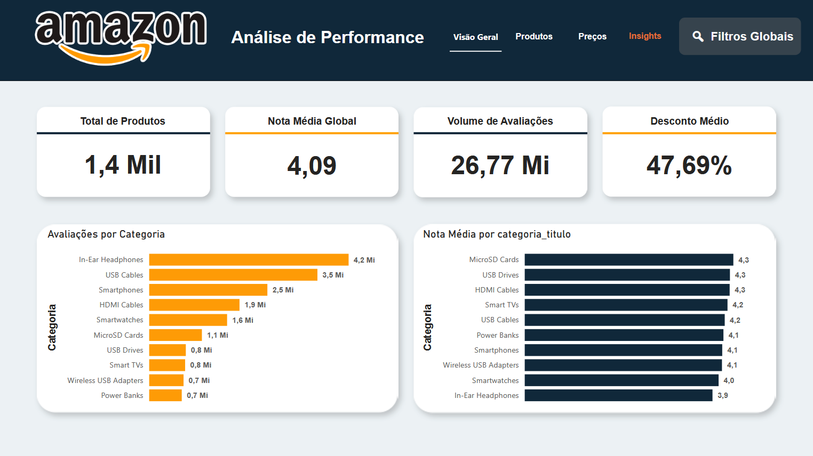

# Amazon Products & Customer Reviews Analysis


## Prévia do Dashboard



Projeto de análise de dados desenvolvido com SQL e Power BI, com o objetivo de explorar informações sobre produtos, preços, descontos, categorias e avaliações de clientes da Amazon.

## Dashboard

[**Acesse o dashboard interativo no Power BI**](https://app.powerbi.com/view?r=eyJrIjoiYmQ1MGE1YjctMmRmZi00ZjZlLWE5YTgtMTM5ZmZhOGJjZDM5IiwidCI6IjgzZWE2ZGJmLTkzYTQtNGZmNy05NTk4LTNhZDA4NWIwNWU4MyJ9)

## Objetivos do projeto

- Explorar dados de produtos e avaliações.
- Analisar a distribuição de produtos por categoria.
- Investigar notas e quantidades de avaliações.
- Comparar preços originais e promocionais.
- Identificar padrões e oportunidades por meio de indicadores e visualizações.

## Ferramentas utilizadas

- **SQL:** exploração, consultas, verificação de qualidade, tratamento de categorias e criação de views.
- **Power BI:** modelagem, construção de indicadores e desenvolvimento do dashboard.

## Etapas do desenvolvimento

1. **Exploração dos dados:** levantamento do volume de registros, produtos, usuários, avaliações e categorias.
2. **Qualidade dos dados:** investigação de valores nulos e possíveis IDs de avaliação duplicados.
3. **Tratamento das categorias:** criação de uma coluna com nomes simplificados para facilitar a leitura das visualizações.
4. **Preparação para análise:** criação da view `vw_avaliacoes` para organizar os campos utilizados no Power BI.
5. **Visualização:** desenvolvimento de um dashboard interativo para explorar os dados.

## Estrutura do repositório

```text
amazon-products-reviews-analysis/
├── sql/
│   ├── 01_exploracao.sql
│   ├── 02_qualidade_dados.sql
│   ├── 03_tratamento_categorias.sql
│   └── 04_view_powerbi.sql
├── dashboard/
│   └── amazon_reviews_dashboard.pbix
├── docs/
│   ├── dicionario_dados.md
│   └── dashboard_preview.png
├── data/
├── README.md
└── .gitignore
```

## Base de dados

A análise utiliza uma base de dados de produtos e avaliações da Amazon, contendo informações sobre identificação dos produtos, categorias, preços, descontos e avaliações de clientes.

## Autor

Desenvolvido como projeto de portfólio na área de Análise de Dados e Business Intelligence.
